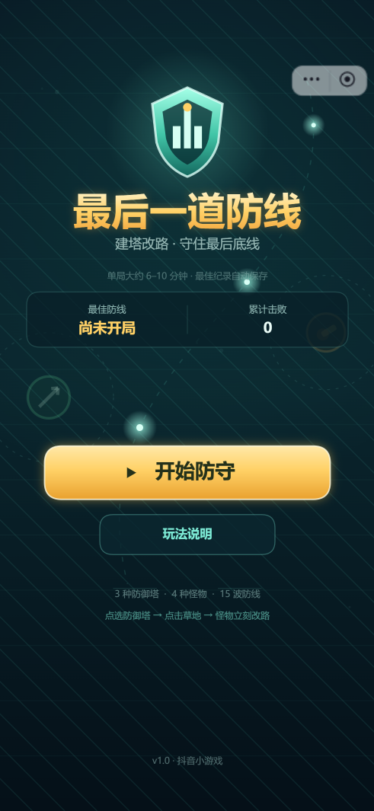
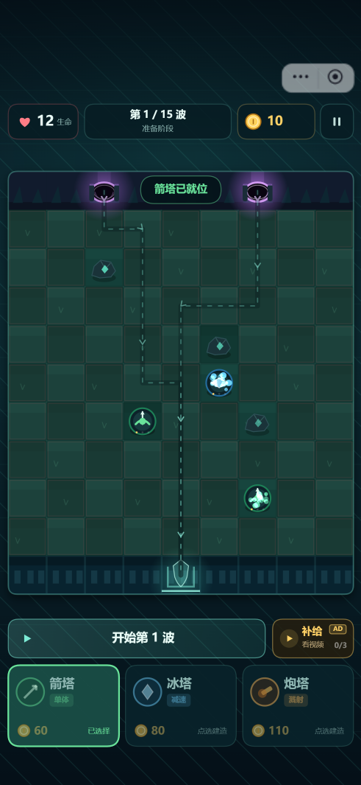
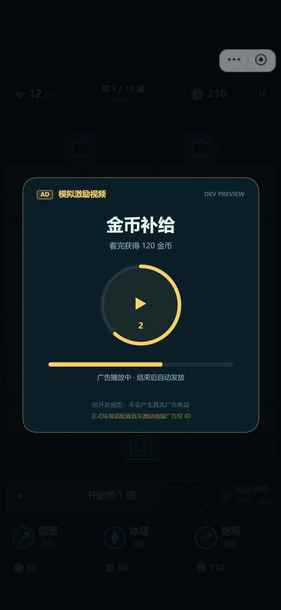
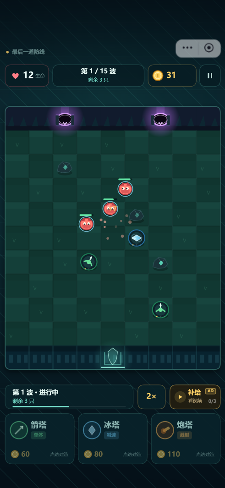

# 最后一道防线 · 抖音小游戏塔防

原生 Canvas 竖屏塔防小游戏。怪物从**顶侧裂隙**出现，目标是进入**底侧基地**；玩家在网格草地上建塔，塔会占位并让怪物**实时绕路**。守住 15 波即可获胜。

- 项目类型：抖音小游戏（microgame）
- 方向：portrait
- 运行方式：抖音开发者工具直接导入项目根目录
- 当前 `appid`：`testAppId`（正式预览/上传前替换为自己的小游戏 AppID）



## 1. 快速运行

1. 打开抖音开发者工具（本项目在 V4.5.7 验证）。
2. 「项目」→「导入项目」，选择本目录（包含 `project.config.json` 的根目录）。
3. 项目类型选「小游戏」，点击编译。
4. 在模拟器中点击「开始防守」。

也可以使用 CLI：

```powershell
douyinide open-project-window -c Codex --path 'D:\awork\douyinGe\塔防版最后一道防线' --type microgame
douyinide simulator-compile -c Codex --window-id <窗口ID>
```

> 默认没有配置激励视频广告位 ID，项目会自动使用「模拟激励视频」走通奖励流程；`testAppId` 无法产生真实广告收益。

## 2. 玩法

- 地图：9 列 × 11 行网格。顶行有两个出生裂隙，底行中央是基地门。
- 初始生命 12 点。怪物抵达基地会扣生命（普通怪 1、重甲 2、首领 5），生命归零即失败。
- 点选底部防御塔卡片，再点草地建造。**塔身会占位，怪物会重新计算最短路线绕过塔。**
- 系统会拒绝会**完全封死**出生点到基地的建塔操作（建塔前对每个出生点和场上怪物做 BFS 可达性检查）。
- 已建塔可以点开升级（最高 Lv.3）或出售（返还 65% 投入）。
- 击杀和清波获得金币；某波**零漏怪**且生命未满时，额外恢复 1 点生命。
- 15 波，第 5 / 10 / 15 波为首领波。可切换 1× / 2× 速度。

### 防御塔

| 塔 | 价格 | 特点 |
|---|---:|---|
| 箭塔 | 60 | 攻速快，单体，优先攻击最接近基地的怪物 |
| 冰塔 | 80 | 范围冰爆，造成减速，适合放在拐角 |
| 炮塔 | 110 | 炮弹落点范围伤害，适合密集怪群 |



## 3. 广告变现接入

广告位统一配置在 [`js/ad-config.js`](js/ad-config.js)。

```js
module.exports = {
  rewardedVideoAdUnitId: '', // 激励视频广告位 ID
  bannerAdUnitId: '',       // Banner 广告位 ID
  interstitialAdUnitId: '', // 插屏广告位 ID
  enableBanner: true,
  enableInterstitial: true,
  // ...
};
```

### 已接入的广告位

| 场景 | 类型 | 触发 | 奖励 / 频控 |
|---|---|---|---|
| 金币补给 | 激励视频 | 对局中点击「补给」 | +120 金币，每局最多 3 次 |
| 防线复活 | 激励视频 | 失败结算页点击「看视频复活」 | 恢复 5 点生命并清空场上怪物，每局 1 次 |
| 首页 / 结算 | Banner | 进入首页或结算页时 | 底部展示，进入对局后隐藏 |
| 重新开局 | 插屏 | 结算后「再来一局」 | 每 3 局最多 1 次，两次展示间隔 ≥ 90 秒 |

### 正式产生收益的步骤

1. 在[抖音开放平台](https://developer.open-douyin.com/)创建小游戏，并将 `project.config.json` 中的 `appid` 替换为真实 AppID。
2. 在「小游戏 → 流量变现 → 广告变现」创建**激励视频 / Banner / 插屏**广告位。
3. 把广告位 ID 填入 `js/ad-config.js`，确保类型与广告位一致。
4. 用「预览」或真机调试验证；开发者工具和 `testAppId` 不能产生真实广告收益。
5. 上线后收益 = 有效广告展示次数 × eCPM / 1000，受填充率、地域、用户质量等影响，无法保证固定金额。

### 安全与合规约定

- 广告位 ID 为空时，激励视频使用 3 秒的**本地模拟广告**，界面明确标注「开发预览、不会产生真实广告收益」；Banner 和插屏不会伪造展示。
- 真实广告未加载、加载失败或用户提前关闭时，**不会发放奖励**。
- 激励视频按钮均带有「AD」标识，不强制观看，不影响正常建塔和通关。
- 上线前请按抖音小游戏最新规范完成隐私、未成年人保护、广告素材和版号/资质相关审核。



## 4. 数值、地图表与关卡

核心配置在 [`js/config.js`](js/config.js)。

### 地图表

`MAP.terrain` 是 9×11 的字符表：

- `S`：顶侧出生裂隙
- `E`：底侧基地门
- `#`：固定岩石，不可建塔、不可通行
- `.`：可建塔草地

出生点和基地出口另有 `MAP.spawns` / `MAP.exit` 明确坐标。顶行只有出生格可通行，底行只有基地门可进入，避免怪物沿着岩壁横走。

修改地图后请保证至少存在一条从每个出生点到基地的路径；游戏启动和建塔时都会做可达性校验。

### 波次表

`WAVES` 是 15 波数组，每组怪物支持：

```js
{ type: 'grunt', count: 6, interval: 1.0, start: 0.3, gate: 0 }
```

- `type`：`grunt` / `runner` / `tank` / `boss`
- `start`：相对本波开始的秒数
- `interval`：同组怪物间隔
- `gate`：指定出生点序号；不填则两个出生点交替

### 数值调整

- 初始金币、生命、补给次数、出售比例：`GAME`
- 塔的伤害/射程/攻速/升级成长：`TOWERS`、`TOWER_LEVELS`
- 怪物血量/速度/护甲/奖励：`ENEMIES`
- 波次血量成长：`GAME.enemyHpGrowth`、`GAME.enemyHpLateGrowth`

## 5. 自动验收接口

游戏把调试接口挂到 `tt.__gameAutomation__`（同时保留 `globalThis.__gameAutomation__`），供开发者工具或自动化脚本读取状态、构造场景。该接口仅用于验收，不参与正常玩法。

常用方法：

```js
tt.__gameAutomation__.getState()
tt.__gameAutomation__.startGame()
tt.__gameAutomation__.startWave()
tt.__gameAutomation__.placeTower('arrow', 3, 6, false)
tt.__gameAutomation__.addCoins(500)
tt.__gameAutomation__.setSpeed(2)
tt.__gameAutomation__.damageBase(12)
tt.__gameAutomation__.finishMockAd()
tt.__gameAutomation__.forceLose()
tt.__gameAutomation__.forceWin()
tt.__gameAutomation__.forceHome()
```

开发者工具示例：

```powershell
douyinide miniapp-execute-js -c Codex --window-id <窗口ID> `
  --js 'JSON.stringify(tt.__gameAutomation__.getState())'
```

状态包含场景、波次、金币、生命、塔、场上怪物数、每个出生点的路径长度/路径格、广告统计、按钮坐标等。关键事件会以 `[TD]` 前缀写入 console，例如 `tower_place`、`wave_clear`、`leak`、`ad_supply_reward`。

## 6. 文件结构

```text
game.js                 入口，创建 Game
game.json               小游戏配置（竖屏）
project.config.json     项目配置 / AppID
icon.png                512×512 图标
js/
  config.js             地图表、塔/怪物/波次数值
  pathfinding.js        BFS 寻路
  game.js               核心状态机、战斗、广告奖励、自动化探针
  renderer.js           全部 Canvas 场景与 UI
  draw.js               圆角、图标、文字等绘制工具
  ads.js                激励视频 / Banner / 插屏封装
  ad-config.js          广告位 ID 与频控配置
  storage.js            本地存档封装
docs/screenshots/       验证截图
```

## 7. 已验证内容

在抖音开发者工具 V4.5.7 + iPhone 15 Pro 模拟器（393×852 CSS）中验证：

- 首页、玩法说明、开始游戏
- 点选箭塔 → 点击草地建造 → 路径实时改写（路径格变化）
- 波次开始、怪物移动、箭塔攻击、2× 加速、清波奖励
- 点击已建塔 → 升级 → 金币与等级变化
- 暂停 / 继续 / 重新开始 / 返回首页
- 激励视频补给：金币 +120，补给次数 1/3，统计 `rewardedCompleted +1`
- 失败结算 → 看视频复活：生命恢复到 5，清空怪物，可继续
- 胜利结算、再来一局、返回首页
- 用 12 座满级塔模拟 15 波，可通关（最终首领仍可能漏 1 只，剩余生命 7）



## 8. 已知限制

- 目前没有音效、排行榜、分享和云存档；这些不影响核心玩法。
- 真实广告位和 Banner/插屏需要在配置真实 AppID + 广告位 ID 后，用真机或预览验证；当前使用 `testAppId`，只验证了模拟激励视频流程。
- 没有后端，成绩保存在本机 `tt` 存储中。
- `tt.__gameAutomation__` 是调试接口，正式上线如需防作弊可移除或加开关。
